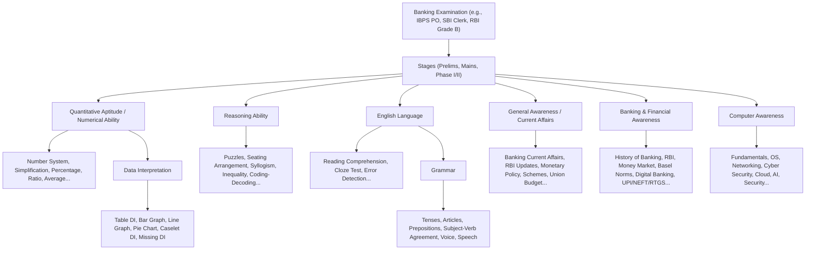

# Banking Exam Syllabus & Question Management System — Implementation Plan

## 1. Executive Summary & Objective

The objective is to upgrade the **HHK Banking Exam Preparation Platform** with a canonical, hierarchical syllabus and question management system modeled after major Indian banking recruitment standards (**IBPS PO, IBPS Clerk, IBPS RRB PO/Clerk, SBI PO, SBI Clerk, RBI Assistant, RBI Grade B**).

The system establishes an unambiguous structural hierarchy:
$$\text{Exam} \longrightarrow \text{Subject} \longrightarrow \text{Topic} \longrightarrow \text{Subtopic} \longrightarrow \text{Difficulty Level} \longrightarrow \text{Questions}$$

### Core Upgrades:
1. **Dynamic Topic & Subtopic Dropdowns**: In the Admin Question Authoring interface (`QuestionBankView`), replace open free-text input with intelligent, context-aware dropdowns populated by section subject, with seamless support for subtopics and custom entries.
2. **Canonical Banking Syllabus Registry**: Centralized repository covering all 6 core banking subjects: Quantitative Aptitude, Reasoning Ability, English Language, General Awareness, Banking & Financial Awareness, and Computer Awareness.
3. **Database Normalization & Subtopic Persistence**: Migration `015` adding `subtopic_name` to `questions` and linking hierarchical `topics`.
4. **Enhanced Student Topic Practice**: Enable students to filter and drill questions by Subject $\rightarrow$ Topic $\rightarrow$ Subtopic with performance tracking and weak-area diagnosis.
5. **Robust Question Bank Bulk Ingestion**: Extended CSV and Excel importer supporting subtopic columns with automatic topic hierarchy resolution.

---

## 2. Canonical Banking Exam Syllabus Hierarchy



---

## 3. Database Schema Design (PostgreSQL)

### Migration `015_banking_syllabus_and_topics.sql`

```sql
-- 1. Ensure subtopic support in questions table
ALTER TABLE questions
  ADD COLUMN IF NOT EXISTS subtopic_name TEXT NOT NULL DEFAULT '';

-- 2. Enhanced topic metadata
ALTER TABLE topics
  ADD COLUMN IF NOT EXISTS code TEXT,
  ADD COLUMN IF NOT EXISTS description TEXT;

-- 3. Composite performance index for rapid topic-wise querying
CREATE INDEX IF NOT EXISTS idx_questions_section_topic_subtopic
  ON questions(section_id, topic_name, subtopic_name)
  WHERE status = 'published';

-- 4. Composite index for student practice sessions
CREATE INDEX IF NOT EXISTS idx_questions_topic_difficulty
  ON questions(topic_name, difficulty)
  WHERE status = 'published';
```

---

## 4. REST API Structure

| Method | Endpoint | Access | Purpose |
| :--- | :--- | :--- | :--- |
| `GET` | `/api/syllabus` | Public / Auth | Returns the complete 6-subject banking syllabus tree (subjects, topics, subtopics). |
| `GET` | `/api/sections/:id/topics` | Public / Auth | Returns the canonical and database-registered topics/subtopics for an exam section. |
| `POST` | `/api/admin/questions` | Admin | Creates a question with validated `topicName` and `subtopicName`, auto-upserting into `topics`. |
| `PUT` | `/api/admin/questions/:id` | Admin | Updates question content, topic, subtopic, difficulty, and options. |
| `POST` | `/api/admin/import` | Admin | Bulk imports questions from CSV/Excel with automatic topic and subtopic normalization. |
| `GET` | `/api/practice/catalog` | Student / Auth | Returns published catalog structured by Exam $\rightarrow$ Stage $\rightarrow$ Section $\rightarrow$ Topic $\rightarrow$ Subtopic. |
